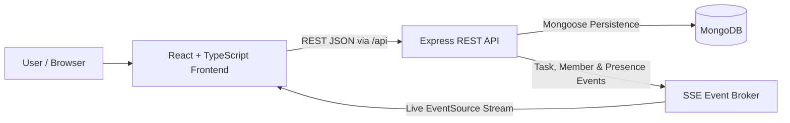

# Collaborative Kanban Board

A full-stack, real-time collaborative Kanban application built with React, TypeScript, Express, and MongoDB. Teams can create and share boards with granular access controls, manage tasks with drag-and-drop, filter via URL-synced search, and stay synchronized across sessions through Server-Sent Events (SSE) and optimistic concurrency handling.


**[Live Application](https://kanban-board-neon-kappa.vercel.app)** · **[Watch Demo Video](https://drive.google.com/file/d/1yjvxfYMxLTk8FFGdo9vteKccPUsUOBVv/view?usp=sharing)** · **[Source Code](https://github.com/abirc8010/Collaborative-Kanban-Board)**

> [!NOTE]
> **Free-Tier Cold Start:** The backend runs on Render's Free Tier and spins down after periods of inactivity. The first request after an idle period may take a short while to wake the service; subsequent requests respond normally.

---

## Table of Contents

- [Screenshots](#screenshots)
- [Key Features](#key-features)
- [Technology Stack](#technology-stack)
- [Architecture](#architecture)
- [Engineering Highlights](#engineering-highlights)
- [Local Setup](#local-setup)
- [API Reference](#api-reference)
- [Deployment](#deployment)
- [Testing](#testing)
- [AI Coding Tools Used](#ai-coding-tools-used)

---

## Screenshots

| Sign In | Dashboard |
| :---: | :---: |
|  |  |
| **Authentication:** Secure login and registration. | **Board Workspace:** Multi-column Kanban management. |

| Search & Filters | Task Details |
| :---: | :---: |
|  |  |
| **URL-Synced Filtering:** Search by title, priority, and assignee. | **Task Inspector:** View and edit task metadata. |

---

## Key Features

### Boards & Task Management
- **Structured Workflow:** Four fixed columns — **Backlog**, **Todo**, **In Progress**, and **Done**.
- **Full CRUD Controls:** Create, rename, and delete multiple boards; create, edit, inspect, and delete tasks with title, description, priority, assignee, status, and position.
- **Drag-and-Drop Reordering:** Move tasks across columns or reorder within a column using `dnd-kit`, persisting normalized column positions via the REST API.

### Search & URL-Synced Filtering
- **Combined Filters:** Filter simultaneously by task title, priority (`low`, `medium`, `high`), and assignee.
- **Persistent State:** Active search and filter parameters sync directly to the URL query string and restore automatically on page refresh or browser navigation.

### Real-Time Collaboration & Security
- **Live SSE Sync:** Real-time broadcasts for task mutations, member updates, presence heartbeats, and instant access revocation.
- **Deduplicated Presence:** Board-scoped presence tracking for authenticated users, deduplicating identical usernames across multiple open tabs.
- **Granular Access Control:** Support for private boards (owners and invited members) and public/link-based sharing with configurable `viewer` and `editor` roles.
- **Hardened Auth:** Username/password authentication backed by Argon2id hashing, SHA-256 hashed opaque session tokens, rate limiting, and CSRF validation.

### Resilient UI Behavior
- **Optimistic Mutations:** Instant local UI updates with targeted rollback on API failure.
- **Permission-Aware Views:** Automatic read-only mode for users without edit privileges.
- **Connection Transparency:** Live SSE connection indicators, board-level error notices, and snapshot resynchronization upon reconnect.

---

## Technology Stack

| Layer | Technologies |
| :--- | :--- |
| **Frontend** | React 18, TypeScript, Vite, Tailwind CSS, Lucide React, `dnd-kit` |
| **Backend** | Node.js, Express 4, Zod, CORS, `express-rate-limit` |
| **Database** | MongoDB, Mongoose |
| **Auth & Security** | Argon2id password hashing, SHA-256 hashed opaque sessions, CSRF token validation |
| **Real-Time** | Server-Sent Events (SSE) with board-scoped event streams |
| **Testing** | Vitest, Supertest |
| **Deployment** | Vercel (Frontend + `/api/*` rewrite proxy), Render (Backend API) |

---

## Architecture



The Vite frontend communicates exclusively through same-origin `/api` routes (proxied in development by Vite and rewritten in production by Vercel). Express handles validation, authorization, and serialized task mutations against MongoDB via Mongoose, while emitting board-scoped Server-Sent Events to active clients.

---

## Engineering Highlights

### Optimistic Updates & Targeted Rollback
1. **Local Application:** Before sending a task mutation, the client applies the change locally, assigns a unique `mutationId`, snapshots only the affected tasks, and tracks pending mutation IDs alongside per-task versions.
2. **Reconciliation:** On success, the server response replaces temporary task IDs and reconciles canonical column positions.
3. **Version-Safe Rollback:** On failure, the client rolls back *only* mutations still matching their tracked version, displays an error notice, and replays any buffered live events—preserving unrelated remote updates rather than resetting the entire board.

### Real-Time Concurrency & Reconnection
- **Event Buffering & Deduplication:** Each board opens an `EventSource` stream to `/api/events` with a `boardId` and generated `connectionId`. Clients maintain a bounded set of processed event IDs (preventing duplicates), tombstones for deleted tasks, and timestamp-based merging.
- **Pending Mutation Protection:** Incoming SSE events touching a task with an in-flight local mutation are buffered until that mutation settles, then replayed.
- **Serialized Backend Writes:** Task mutations are serialized server-side to guarantee consistent, normalized column ordering.
- **Reconnect Resync:** Rather than relying solely on SSE continuity, reconnecting clients fetch a fresh board snapshot and merge it cleanly with any pending local changes.

---

## Local Setup

### Prerequisites
- **Node.js** `>= 20`
- **npm** `>= 10`
- **MongoDB** (local instance or MongoDB Atlas)

### 1. Clone and Install

This repository uses npm workspaces (`frontend` and `backend`). Run from the repository root:

```sh
git clone [https://github.com/abirc8010/Collaborative-Kanban-Board.git](https://github.com/abirc8010/Collaborative-Kanban-Board.git)
cd Collaborative-Kanban-Board
npm install
```

### 2. Configure Environment Variables

**Backend:**

```sh
cp backend/.env.example backend/.env
```

```dotenv
PORT=4000
MONGODB_URI=mongodb://127.0.0.1:27017/kanban
CLIENT_ORIGIN=http://localhost:5173
SIMULATE_API_FAILURE=false
```

| Variable | Description |
| :--- | :--- |
| `PORT` | Port the Express server listens on (default `4000`). |
| `MONGODB_URI` | MongoDB connection string. |
| `CLIENT_ORIGIN` | Allowed frontend origin for CORS (`*` accepted in dev only when explicitly set). |
| `SIMULATE_API_FAILURE` | Dev-only flag to trigger deterministic mutation failures for testing UI rollback. |

**Frontend:**

```sh
cp frontend/.env.example frontend/.env
```

The example file configures `API_PROXY_TARGET` for the Vite dev proxy. No `VITE_` API URL is needed because the frontend makes same-origin `/api` requests.

### 3. Run the Application

Ensure MongoDB is running and reachable at `MONGODB_URI`, then start both workspaces:

```sh
npm run dev
```

| Service | Local URL |
| :--- | :--- |
| **Frontend** | `http://localhost:5173` |
| **Backend API** | `http://localhost:4000` |
| **Health Check** | `http://localhost:4000/api/health` |

---

## API Reference

All endpoints are prefixed with `/api`. Mutating requests require an authenticated session and a matching `X-CSRF-Token` header unless noted otherwise (such as public auth routes or link-based editor access).

### System & Authentication

| Method | Endpoint | Description | Access |
| :--- | :--- | :--- | :--- |
| `GET` | `/api/health` | Check backend and database availability | Public |
| `POST` | `/api/auth/register` | Create an account and start a session | Public, rate limited |
| `POST` | `/api/auth/login` | Authenticate and create a session | Public, rate limited |
| `GET` | `/api/auth/me` | Fetch current user profile and CSRF token | Optional session |
| `POST` | `/api/auth/logout` | Terminate the active session | Authenticated, CSRF |
| `POST` | `/api/auth/change-password` | Update password and revoke other sessions | Authenticated, CSRF |

### Boards & Access Management

| Method | Endpoint | Description | Access |
| :--- | :--- | :--- | :--- |
| `GET` | `/api/boards` | List boards owned or joined by the user | Authenticated |
| `POST` | `/api/boards` | Create a new board | Authenticated, CSRF |
| `GET` | `/api/boards/:boardId` | Fetch board details and caller's access role | Board access |
| `PATCH` | `/api/boards/:boardId` | Rename board or update visibility/link access | Owner, CSRF |
| `DELETE` | `/api/boards/:boardId` | Delete a board and all associated tasks | Owner, CSRF |
| `POST` | `/api/boards/:boardId/members` | Invite a registered user to the board | Owner, CSRF |
| `PATCH` | `/api/boards/:boardId/members/:userId` | Update an existing member's role | Owner, CSRF |
| `DELETE` | `/api/boards/:boardId/members/:userId` | Remove a member from the board | Owner, CSRF |

### Tasks & Real-Time Events

| Method | Endpoint | Description | Access |
| :--- | :--- | :--- | :--- |
| `GET` | `/api/board?boardId=:boardId` | Fetch all tasks for a board | Board access |
| `POST` | `/api/tasks` | Create a new task | Editor / link editor, CSRF |
| `PATCH` | `/api/tasks/:id?boardId=:boardId` | Update task fields or move/reorder task | Editor / link editor, CSRF |
| `DELETE` | `/api/tasks/:id?boardId=:boardId` | Delete a task | Editor / link editor, CSRF |
| `GET` | `/api/events?boardId=:boardId&connectionId=:id` | Open a board-scoped SSE event stream | Board access |
| `POST` | `/api/boards/:boardId/presence/heartbeat` | Refresh an authenticated SSE presence lease | Authenticated, CSRF |

---

## Deployment

- **Frontend (Vercel):** [https://kanban-board-neon-kappa.vercel.app](https://kanban-board-neon-kappa.vercel.app)
- **Backend (Render):** [https://collaborative-kanban-api-hsq1.onrender.com](https://collaborative-kanban-api-hsq1.onrender.com)

Vercel serves the frontend and rewrites `/api/*` traffic to Render, keeping both REST and SSE requests same-origin in the browser. Render injects `MONGODB_URI` and `CLIENT_ORIGIN` at runtime and monitors `/api/health` for health checks.

---

## Testing

The repository runs unit, integration, type, and production-build verification across both workspaces:

- **Backend (Vitest + Supertest):** API routes, Zod validation, board access control, task ordering services, auth helpers, and SSE broadcasting.
- **Frontend (Vitest):** Task sorting, filtering, URL state synchronization, board routing, and optimistic rollback utilities.

Run all checks from the repository root:

```sh
npm test
npm run typecheck
npm run build
```

Or target an individual workspace:

```sh
npm test --workspace backend
npm test --workspace frontend
npm run build --workspace backend
npm run build --workspace frontend
```

**Latest Verification Results:**

```text
npm test          -> 48 passed (39 backend, 9 frontend)
npm run typecheck -> passed
npm run build     -> passed
```

---

## AI Coding Tools Used

- **GitHub Copilot (Free Plan):** Used for inline code completion, suggestions, and coding assistance.