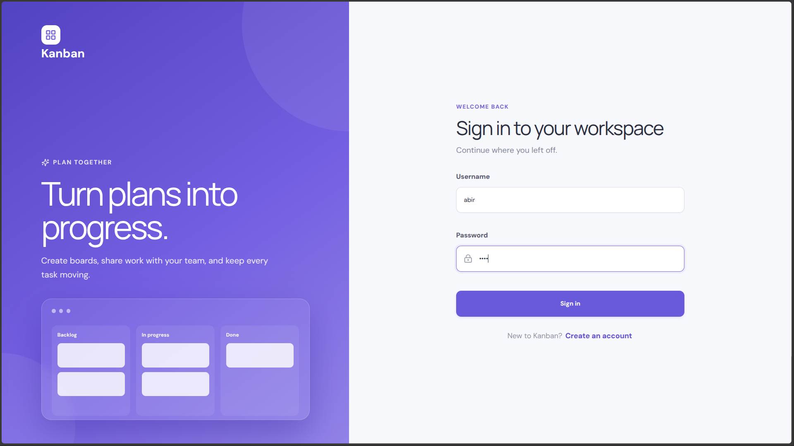
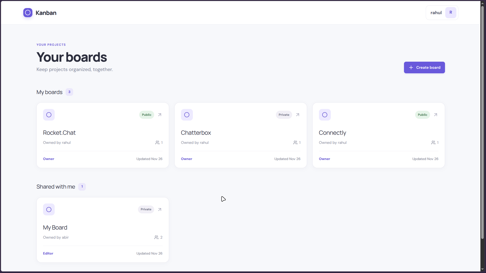
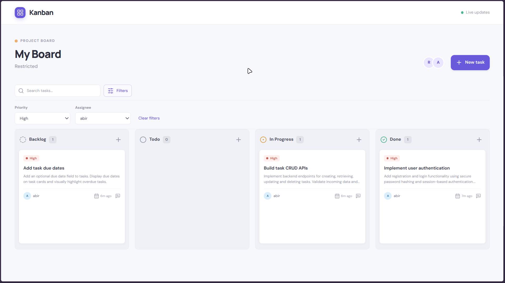
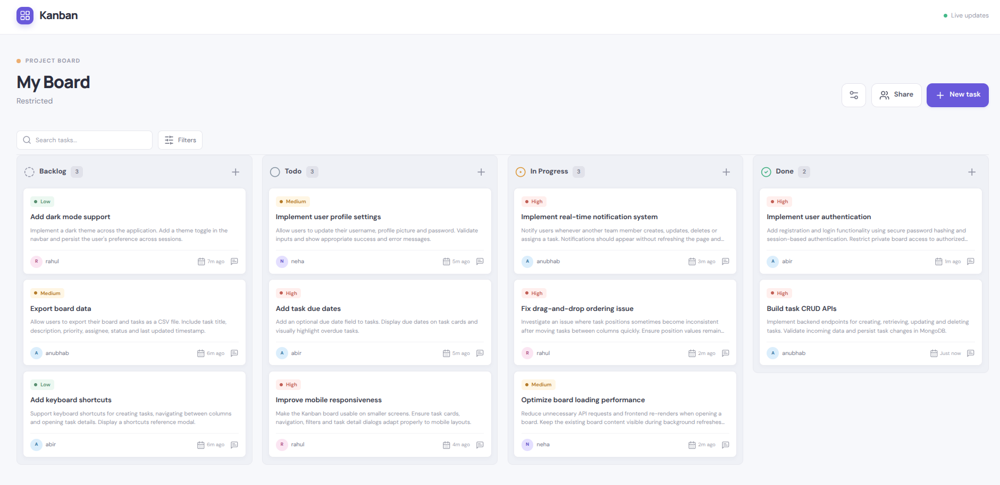
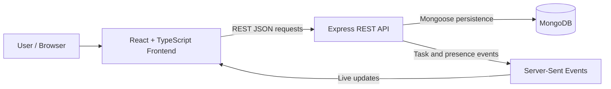

# Collaborative Kanban Board

A full-stack collaborative project management application for organizing work across Kanban boards. Users can create and share boards, manage tasks, filter work, and receive live updates from other connected users.

- **Live Application:** [https://kanban-board-neon-kappa.vercel.app](https://kanban-board-neon-kappa.vercel.app)
- **Source Code:** [https://github.com/abirc8010/Collaborative-Kanban-Board](https://github.com/abirc8010/Collaborative-Kanban-Board)
- **Demo Video:** [Watch the Demo](ADD_DEMO_VIDEO_URL)

> **⚠️ Deployment Notice: The backend is hosted on Render's Free Tier. Due to free-tier limitations, the service may spin down after periods of inactivity. Consequently, the first request after an idle period may experience increased latency or a delay while the service wakes up. Subsequent requests may be faster once the service is active.**

## Technology Stack

| Frontend | Backend | Data & Security | Real-time & Deployment |
|---|---|---|---|
| React 18, TypeScript, Vite | Node.js, Express 4 | MongoDB, Mongoose | Server-Sent Events (SSE) |
| Tailwind CSS, Lucide React | Zod, CORS, express-rate-limit | Argon2id, opaque sessions, CSRF checks | Vercel and Render |
| dnd-kit | Vitest, Supertest | SHA-256 session token hashes | — |

## Screenshots

| Sign In | Dashboard |
|---|---|
|  |  |
| **Sign In:** User authentication. | **Dashboard:** View and manage Kanban boards. |

| Search and Filters | Task Details |
|---|---|
|  |  |
| **Search and Filters:** Find tasks using combined search and filtering. | **Task Details:** View and edit individual tasks. |

## Demo Video

[Watch the Demo](ADD_DEMO_VIDEO_URL)

## Features

### Boards and tasks

- Four fixed Kanban columns: **Backlog**, **Todo**, **In Progress**, and **Done**.
- Create multiple boards, rename or delete boards, and fetch tasks grouped by status.
- Create, edit, delete, and inspect tasks with title, description, priority, assignee, status, and position.
- Move tasks between columns or reorder tasks within a column with drag and drop.
- Persist task status and normalized column positions through the REST API.

### Search and filters

- Search by task title.
- Filter by low, medium, or high priority.
- Filter by assignee.
- Combine search and filters; active values are stored in URL query parameters and restored on refresh or browser navigation.

### Collaboration and access

- Live task creation, updates, deletion, board-member changes, presence, and access revocation through SSE.
- Board-specific presence for authenticated users, with duplicate usernames deduplicated across tabs.
- Private boards restricted to owners and invited members.
- Public boards or link-based access with configurable viewer/editor roles.
- Owner management of board settings, general access, invitations, and member roles.
- Username/password authentication, Argon2id password hashing, hashed opaque sessions, and CSRF validation.

### Interface behavior

- Optimistic task changes with rollback after failed API requests.
- Read-only task and board views for users without editor permissions.
- Live connection status and board-level error notices.
- Reconnection resynchronization to avoid relying on SSE alone for the latest snapshot.

## Architecture



The Vite frontend communicates with Express through `/api`. MongoDB stores users, sessions, boards, board membership, tasks, and migration state through Mongoose. Server-Sent Events deliver board-scoped updates to connected browser clients.

## Important Engineering Decisions

### Optimistic updates and rollback

Before a task mutation is sent, the frontend immediately applies the expected change to local state and assigns a unique mutation ID. It retains the affected tasks' previous state and separately tracks pending mutation IDs and task versions.

If the API request fails, the frontend restores only mutations that are still at their tracked version. A server response replaces the temporary task ID or reconciles canonical task positions. Failed mutations show an error notice, and queued live events are replayed after the rollback or reconciliation. This avoids replacing the whole board and helps preserve unrelated remote changes.

### Real-time collaboration and concurrent changes

Each board view opens an `EventSource` connection to `/api/events` with a board ID and generated connection ID. The backend sends named SSE events for task create, update, and delete operations, plus board membership, presence, and access-revocation events.

Clients keep a set of handled event IDs, a mutation-ID buffer, tombstones for deleted tasks, and timestamp-based task merging. Events affecting a pending optimistic mutation are buffered until that mutation settles. Remote events are otherwise merged into the current task map rather than replacing the complete board. On reconnection, the client fetches a fresh snapshot and merges it with pending local changes.

Task mutations are serialized on the backend. Updates normalize and persist affected column positions, and create/update/delete broadcasts include relevant task data and mutation IDs. Repeated event IDs are ignored within the client's bounded deduplication set.

## Installation and Local Setup

### Prerequisites

- Node.js 20 or newer
- npm 10 or newer
- MongoDB, such as a local instance or MongoDB Atlas

### 1. Clone and install

Run from the repository root:

```sh
git clone https://github.com/abirc8010/Collaborative-Kanban-Board.git
cd Collaborative-Kanban-Board
npm install
```

This repository uses npm workspaces for `frontend` and `backend`.

### 2. Configure the backend

Create a local backend environment file:

```sh
cp backend/.env.example backend/.env
```

Set `backend/.env` using safe local placeholders:

```dotenv
PORT=4000
MONGODB_URI=mongodb://127.0.0.1:27017/kanban
CLIENT_ORIGIN=http://localhost:5173
SIMULATE_API_FAILURE=false
```

- `PORT`: backend listening port.
- `MONGODB_URI`: MongoDB connection URI.
- `CLIENT_ORIGIN`: allowed frontend origin. Development also accepts `*` only when explicitly configured through `CLIENT_ORIGIN`.
- `SIMULATE_API_FAILURE`: development-only deterministic mutation failures for testing frontend rollback.

### 3. Configure the frontend

```sh
cp frontend/.env.example frontend/.env
```

The included example configures `API_PROXY_TARGET` for the Vite development proxy. No `VITE_` API URL is required because the frontend uses same-origin `/api` requests.

### 4. Start MongoDB and the application

Ensure MongoDB is running and reachable from `MONGODB_URI`, then start both workspaces from the repository root:

```sh
npm run dev
```

- Frontend: `http://localhost:5173`
- Backend: `http://localhost:4000`
- API health: `http://localhost:4000/api/health`

Vite proxies `/api` to `http://localhost:4000` in development unless `API_PROXY_TARGET` is set.

### 5. Run checks

```sh
npm test
npm run typecheck
npm run build
```

Run these commands from the repository root. Individual workspace commands are also available:

```sh
npm test --workspace backend
npm test --workspace frontend
npm run build --workspace backend
npm run build --workspace frontend
```

## API Reference

All routes are served below `/api`. Mutating routes require an authenticated session and a matching `X-CSRF-Token`, except public/editor-link behavior where noted. Board routes require access to the referenced board.

| Method | Route | Purpose | Access |
|---|---|---|---|
| `GET` | `/api/health` | Report backend and database availability | Public |
| `POST` | `/api/auth/register` | Create an account and session | Public, rate limited |
| `POST` | `/api/auth/login` | Authenticate and create a session | Public, rate limited |
| `GET` | `/api/auth/me` | Return the current user and CSRF token | Optional session |
| `POST` | `/api/auth/logout` | End the current session | Authenticated, CSRF |
| `POST` | `/api/auth/change-password` | Change the password and close other sessions | Authenticated, CSRF |
| `GET` | `/api/boards` | List boards owned or joined by the user | Authenticated |
| `POST` | `/api/boards` | Create a board | Authenticated, CSRF |
| `GET` | `/api/boards/:boardId` | Read board details and access role | Board access |
| `PATCH` | `/api/boards/:boardId` | Rename or change visibility/link access | Owner, CSRF |
| `DELETE` | `/api/boards/:boardId` | Delete a board and its tasks | Owner, CSRF |
| `POST` | `/api/boards/:boardId/members` | Invite a registered user | Owner, CSRF |
| `PATCH` | `/api/boards/:boardId/members/:userId` | Change a member role | Owner, CSRF |
| `DELETE` | `/api/boards/:boardId/members/:userId` | Remove a member | Owner, CSRF |
| `POST` | `/api/boards/:boardId/presence/heartbeat` | Refresh an authenticated SSE presence lease | Authenticated, CSRF |
| `GET` | `/api/board?boardId=:boardId` | Read tasks for a board | Board access |
| `POST` | `/api/tasks` | Create a task | Editor or link editor; CSRF |
| `PATCH` | `/api/tasks/:id?boardId=:boardId` | Update or move a task | Editor or link editor; CSRF |
| `DELETE` | `/api/tasks/:id?boardId=:boardId` | Delete a task | Editor or link editor; CSRF |
| `GET` | `/api/events?boardId=:boardId&connectionId=:id` | Open a board's SSE event stream | Board access |

## Deployment

**Frontend:** [https://kanban-board-neon-kappa.vercel.app](https://kanban-board-neon-kappa.vercel.app)

**Backend:** [https://collaborative-kanban-api-hsq1.onrender.com](https://collaborative-kanban-api-hsq1.onrender.com)

The frontend is hosted on Vercel and rewrites same-origin `/api/*` requests to the Render backend. The rewrite keeps browser API and SSE requests under the frontend origin. The backend is hosted on Render, reads `MONGODB_URI` and `CLIENT_ORIGIN` at runtime, and exposes `/api/health` as its health check.

> **⚠️ Deployment Notice: Because the backend uses Render's Free Tier, it may spin down after inactivity. The first request after an idle period can take longer while the service becomes active; later requests can be faster once running.**

## Testing

The repository includes backend and frontend Vitest suites:

- Backend: Express/Supertest application behavior, validation, board access, task services, authentication helpers, and SSE broadcasting.
- Frontend: task ordering, filtering, URL state, board routes, and optimistic board utilities.
- TypeScript: separate backend and frontend type checks.
- Production build: TypeScript compilation followed by the Vite production bundle.

Verified with:

```text
npm test       -> 48 tests passed (39 backend, 9 frontend)
npm run typecheck -> passed
npm run build  -> passed
```

## AI Coding Tools Used

GitHub Copilot (Free Plan): Used for AI-assisted code completion, suggestions and coding assistance.
